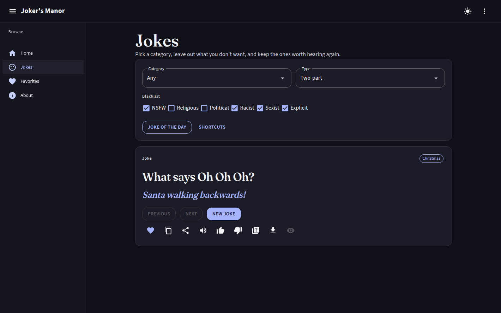
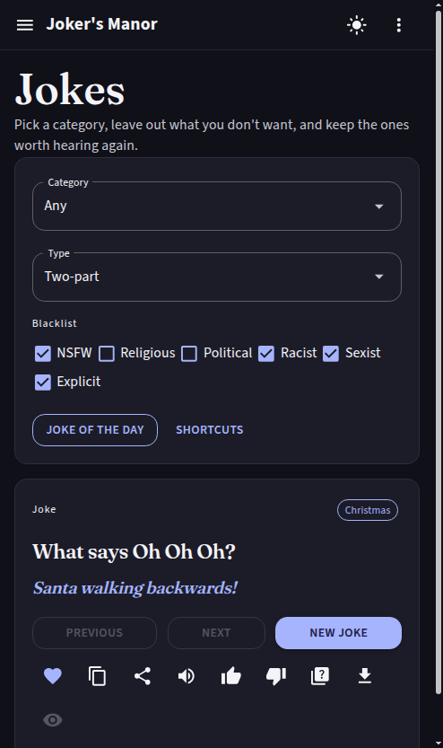

# JokerBlazor

[](https://dotnet.microsoft.com/)
[](https://dotnet.microsoft.com/apps/aspnet/web-apps/blazor)
[](https://mudblazor.com/)
[](https://v2.jokeapi.dev/)

**Live site: [https://daydin14.github.io/JokerBlazor/](https://daydin14.github.io/JokerBlazor/)**

JokerBlazor is a standalone Blazor WebAssembly app. It runs in the browser and is published to GitHub Pages. It still targets `net10.0`. `global.json` uses `rollForward: latestMajor`, so the .NET 11 SDK can build it.

## Pictures

### Desktop




### Phone




## What you can do

- Filter by category (Any, Programming, Pun, Misc, Dark, Spooky, Christmas), joke type, and blacklist flags. NSFW, racist, sexist, and explicit start selected. The choice is saved in this browser.
- Hide a two-part delivery until you reveal it.
- Save favorites, search them, and remove them. Thumbs-up jokes show under Your top jokes.
- Copy a joke, use the device share sheet when the browser has one, or open a permalink such as `/JokerBlazor/jokes?id=244`.
- Step back and forward through this visit. A new joke skips ones already seen in the session.
- Load a Joke of the Day. The id comes from the date, so everyone gets the same one.
- Hear the joke with the browser speech API.
- Guess a two-part punchline. A correct guess celebrates; motion is skipped when the system asks for less motion.
- Download a PNG joke card.
- Install the app. The service worker caches the app shell, and the last jokes plus favorites stay in local storage for offline use.
- Keyboard: Space or N next, F favorite, R reveal, C copy, ? shortcuts.

## Run it locally

The repo asks for the .NET 10 SDK, and a newer SDK such as .NET 11 is accepted.

```bash
cd JokerBlazor
dotnet run --project JokerBlazor --launch-profile http
```

Open [http://localhost:5236](http://localhost:5236).

To preview the GitHub Pages path:

```bash
dotnet publish JokerBlazor/JokerBlazor/JokerBlazor.csproj -c Release -o publish
python3 scripts/prepare-github-pages.py publish/wwwroot
```

Serve `publish/wwwroot` as `/JokerBlazor/`.

## GitHub Pages

[`.github/workflows/pages.yml`](.github/workflows/pages.yml) publishes on every push to `master`. The site source is GitHub Actions. The published base href is `/JokerBlazor/`. `wwwroot/.nojekyll` keeps `_framework`, and `wwwroot/404.html` restores routes such as `/JokerBlazor/jokes`.

[`.github/workflows/dotnet.yml`](.github/workflows/dotnet.yml) builds, tests, and checks the publish output. It does not deploy.

## Libraries

- [MudBlazor](https://www.nuget.org/packages/MudBlazor) 9.14.0 for the layout, skeleton placeholders, and snackbar toasts. MIT.
- [Blazored.LocalStorage](https://www.nuget.org/packages/Blazored.LocalStorage) 4.5.0 for filters, favorites, ratings, and the offline joke list. MIT.
- [canvas-confetti](https://github.com/catdad/canvas-confetti) 1.9.3, self-hosted at `wwwroot/js/confetti.browser.js`. ISC.
- Short CSS keyframes for the joke fade-in, punchline slide-up, and favorite pop. They are turned off under `prefers-reduced-motion`, which also disables the confetti burst.

## Project layout

- `JokerBlazor/JokerBlazor` is the WebAssembly app.
- `JokerBlazor/JokerBlazor.Core` holds filters, history, favorites, ratings, quiz checks, and the joke of the day.
- `JokerBlazor/JokerBlazor.Tests` covers that logic with xUnit and bUnit.
