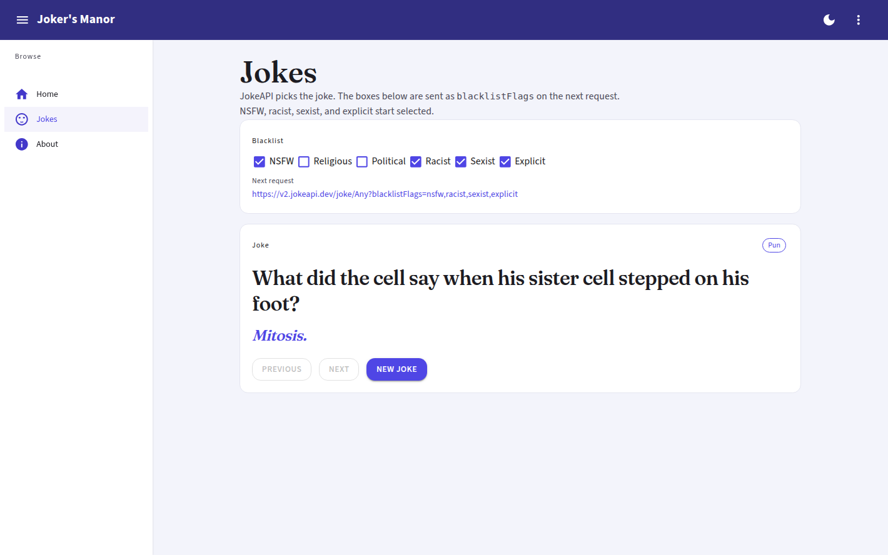
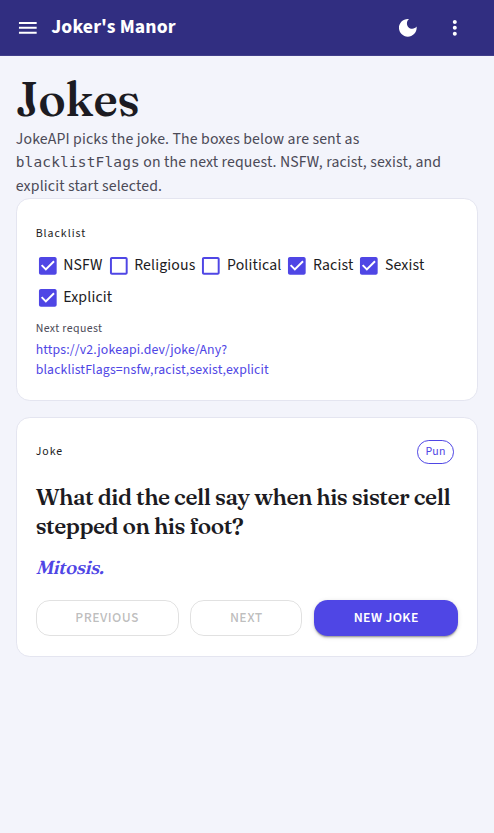

# JokerBlazor

[](https://dotnet.microsoft.com/)
[](https://dotnet.microsoft.com/apps/aspnet/web-apps/blazor)
[](https://mudblazor.com/)
[](https://v2.jokeapi.dev/)

**Live site: [https://daydin14.github.io/JokerBlazor/](https://daydin14.github.io/JokerBlazor/)**

JokerBlazor is a standalone Blazor WebAssembly app. It runs in the browser and is published to GitHub Pages as static files. Ask JokeAPI for a joke, blacklist topics you want to skip, and step back through the jokes from this visit. Light and dark mode are both included.

## Pictures

### Desktop




### Phone




## Run it locally

Install the [.NET 10 SDK](https://dotnet.microsoft.com/download) (the current LTS).

```bash
cd JokerBlazor
dotnet run --project JokerBlazor --launch-profile http
```

Open [http://localhost:5236](http://localhost:5236). The dev server hosts the app at `/`.

The GitHub Pages site is served under `/JokerBlazor/`. To preview that path, publish and rewrite the base href the same way the deploy workflow does:

```bash
dotnet publish JokerBlazor/JokerBlazor/JokerBlazor.csproj -c Release -o publish
python3 scripts/prepare-github-pages.py publish/wwwroot
```

Then serve the `publish/wwwroot` folder as `/JokerBlazor/`.

## GitHub Pages

[`.github/workflows/pages.yml`](.github/workflows/pages.yml) publishes the Release WebAssembly app on every push to `master` and deploys it with GitHub Actions.

This repository currently publishes Pages from the `gh-pages` branch (`Deploy from a branch`). That setting will not use the new workflow, and [https://daydin14.github.io/JokerBlazor/](https://daydin14.github.io/JokerBlazor/) is a 404 today.

**Change this before the site can go live:** Settings → Pages → Build and deployment → Source → **GitHub Actions**.

Switch the source, then merge. If the merge happens first, the "Deploy to GitHub Pages" workflow fails until the source is GitHub Actions. Re-run that workflow after the switch. The public URL does not change.

The published `index.html` uses `<base href="/JokerBlazor/" />`. `wwwroot/.nojekyll` keeps the `_framework` folder from being dropped, and `wwwroot/404.html` sends a direct visit to a route such as `/JokerBlazor/jokes` back into the app.

[`.github/workflows/dotnet.yml`](.github/workflows/dotnet.yml) restores, builds, tests, and checks that publish output on pull requests and on `master`. It does not deploy.

## Jokes

Jokes come from [JokeAPI](https://v2.jokeapi.dev/). A browser `GET` to `https://v2.jokeapi.dev/joke/Any` returns `Access-Control-Allow-Origin: *`, so the page calls it directly. `https://sv443.net/jokeapi/v2` sends the same header. The app uses `v2.jokeapi.dev`, which is the host already linked from the menu.

Both one-line jokes and setup/punchline jokes are shown. NSFW, racist, sexist, and explicit start blacklisted. Clear a box to allow that flag on the next request.

## Project layout

The app targets `net10.0`.

- `JokerBlazor/JokerBlazor` is the WebAssembly app that gets published.
- `JokerBlazor/JokerBlazor.Core` holds the JokeAPI client.
- `JokerBlazor/JokerBlazor.Tests` covers request URLs and joke parsing.

GitHub Pages cannot host the old Blazor Web App. That project needed a server for Interactive Server rendering. Counter and Weather were template pages and are not part of this app. Logging goes to the browser console.

## Packages

- [MudBlazor](https://www.nuget.org/packages/MudBlazor) 9.14.0
- [Microsoft.AspNetCore.Components.WebAssembly](https://www.nuget.org/packages/Microsoft.AspNetCore.Components.WebAssembly) 10.0.15
